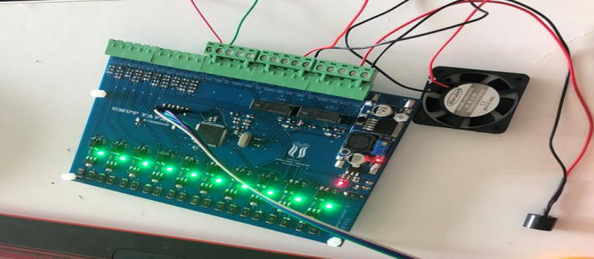
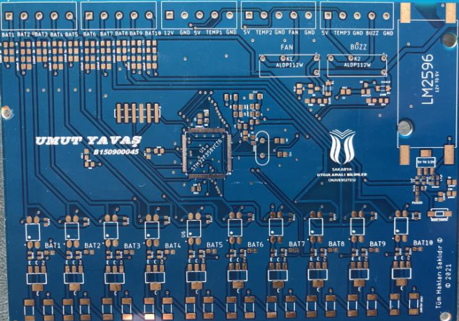
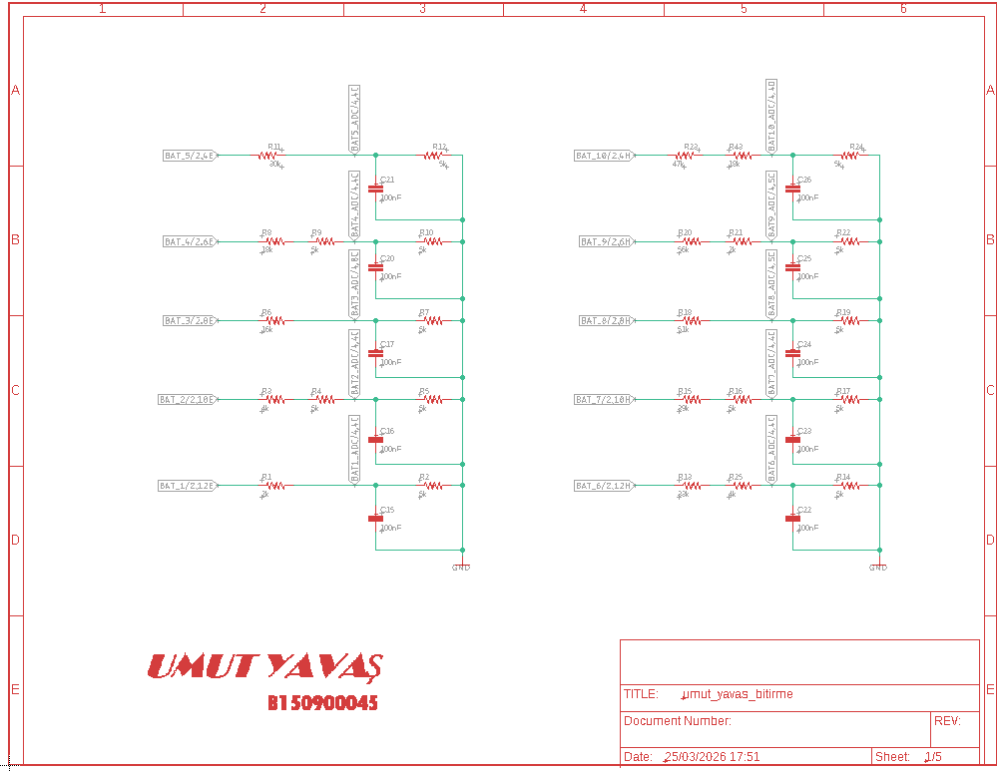
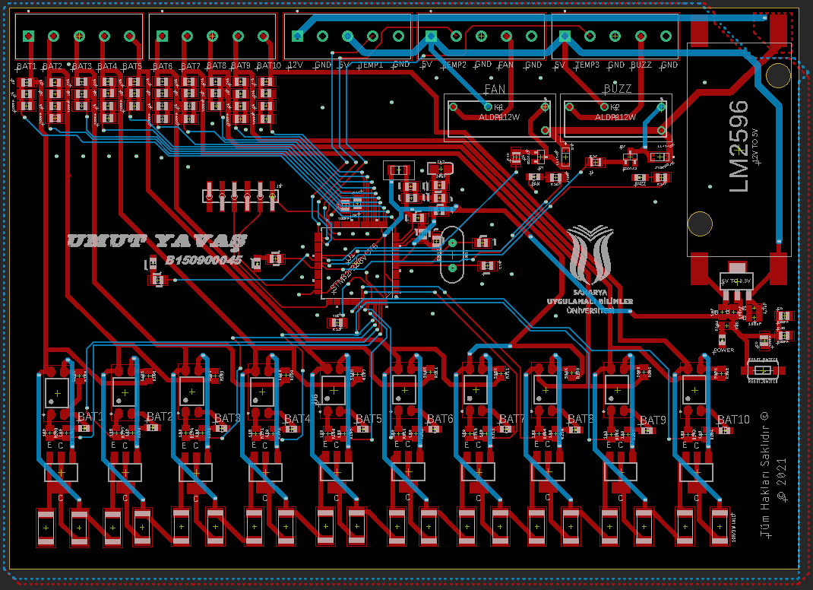
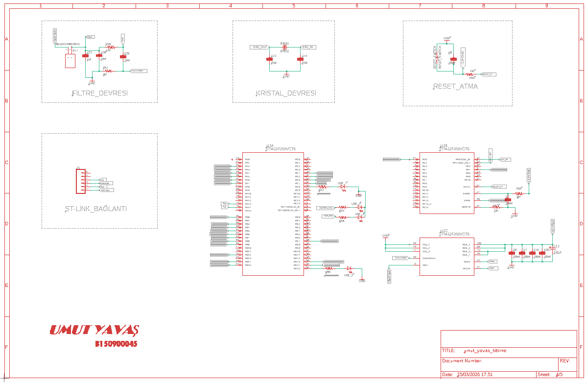
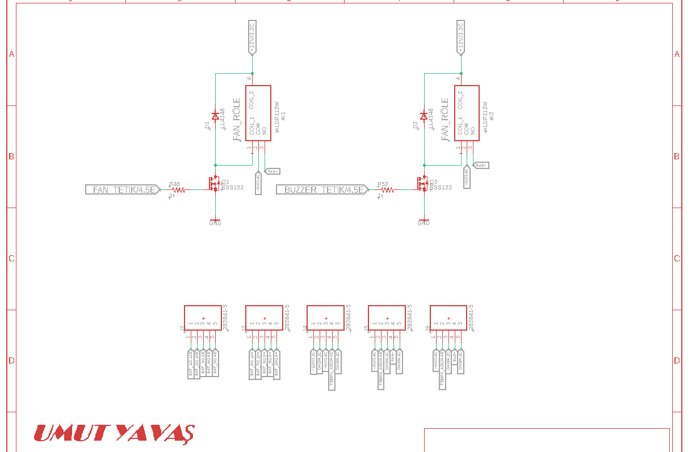
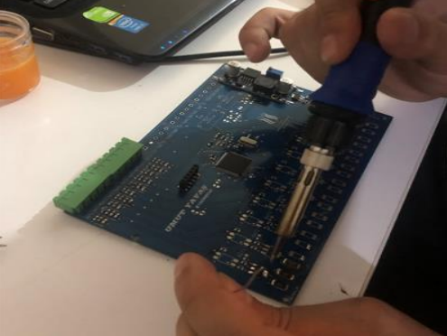
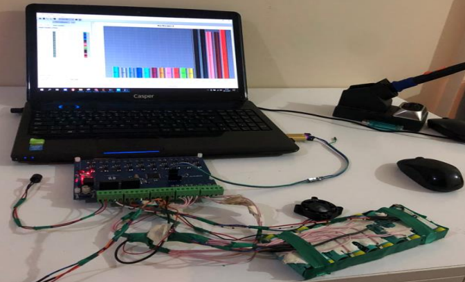

# Battery Management System (BMS): Thesis Project

A complete battery management system for a **10-cell series Li-ion pack**, from schematic and custom PCB to assembled hardware and STM32 firmware. Developed as a thesis project at Sakarya University of Applied Sciences.

<p align="center">
  
  
</p>

**Tech:** C · STM32F3 (HAL) · STM32CubeIDE · PCB design · ADC + DMA · UART

---

## ✨ Features

| Function | Implementation |
|---|---|
| **Cell voltage monitoring** | 10 cells measured through resistor dividers on 14 ADC channels with DMA, software-filtered and individually calibrated per channel |
| **Passive cell balancing** | Any cell more than **60 mV above the pack average** has its bleed resistor switched on; outputs are reset every cycle |
| **State of charge (SoC)** | Estimated from total pack voltage via a lookup table |
| **Thermal management** | 5 temperature sensors; buzzer warning above 35 °C, cooling fan above 55 °C |
| **Telemetry** | Cell voltages, temperatures, SoC and pack voltage streamed over UART as a framed packet for a PC monitoring interface |
| **Hardware** | Custom PCB with LM2596 buck regulator, MOSFET drivers for fan / buzzer / contactor, and status LEDs |

---

## 🔁 Firmware cycle

A 100 ms hardware timer (TIM1) drives an 8-step control cycle:

```
 step 1   Read & filter all ADC channels → apply per-cell calibration → compute pack total and average
 step 4   Balancing: enable bleed on every cell > average + 60 mV
 step 4   Temperature check → buzzer / fan · UART telemetry frame
 every 500 ms   SoC update
 step 8   Reset all balancing outputs, start next cycle
```

---

## 📸 Design & build

| Schematic | PCB layout |
|---|---|
|  |  |
|  |  |

| Assembly | Testing |
|---|---|
|  |  |

---

## 📂 Repository structure

```
BMS/
├── Core/
│   ├── Src/
│   │   ├── main.c          # Main loop: balancing, SoC, thermal control, UART telemetry
│   │   ├── adc_filter.c    # ADC averaging and filtering
│   │   ├── timer.c         # Timing / cycle scheduler
│   │   └── stm32f3xx_it.c  # Interrupt handlers (incl. temperature conversion)
│   └── Inc/
└── Drivers/                # STM32 HAL & CMSIS
bms_photo/                  # Schematics, PCB and hardware photos
```

## ▶️ Building

Open the `BMS` folder as a project in **STM32CubeIDE**, then build and flash with an ST-Link.
